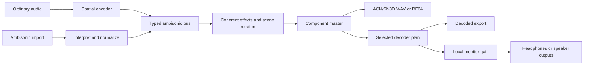

# Soundscaper ambisonics implementation guide

This guide defines the proposed contracts and implementation sequence for
first-, second-, and third-order ambisonics in Soundscaper. The
[post-1.0 roadmap](../../roadmap.md#9-soundscaper-ambisonics-orders-13) owns scope,
status, and release sequencing. These are planned capabilities; this document
does not enable them or allocate a project schema version.

## Scope and user workflow

Deliver a complete workflow for importing a spatial recording, editing its
components together, rotating the scene, mixing positioned sources into it,
monitoring on headphones, and exporting either ambisonic components or a
decoded listening format. Use one shared implementation with an explicit order:

| Order | Full-sphere components | Zero-based ACN indices | Delivery sequence |
| --- | --- | --- | --- |
| First, FOA | 4 | 0–3 | First complete vertical slice. |
| Second, HOA | 9 | 0–8 | Extend and qualify the same contracts after FOA. |
| Third, HOA | 16 | 0–15 | Extend and qualify after second order. |

Support complete three-dimensional component sets. Horizontal-only,
mixed-order, orders above three, microphone-specific raw A-format conversion,
personalized HRTFs, device head tracking, and six-degree-of-freedom scene
translation are outside this packet. CAF ambix containers, legacy higher-order
FuMa, ADM HOA authoring, and spatial metadata in compressed/video containers
are separate extensions. Existing ADM passthrough must retain its current rules.

All new actions are opt-in through existing menus. Proposed entries are
**Tracks > Ambisonics** for interpretation, bus order, and source placement;
**Effect > Ambisonics > Rotate scene** for an editable rotation;
**View > Ambisonic monitoring** for the listening configuration; and
**File > Export other > Ambisonic WAV** for component delivery. Put decoded
outputs in the existing audio-export workflow. These entries are proposed,
not current commands. File import can offer an interpretation dialog when
metadata proves ambisonic intent; an untagged file requires an explicit menu
action. Each workflow must be keyboard accessible and restore focus.

Keep order, placement, and rotation controls in the invoked dialogs and
existing automation workflows. Add no persistent toolbar button, panel, rail,
badge, or inline control. Localize new copy through the
[localization workflow](localization.md).

## Existing architecture and ownership

Follow [architecture and maintainability](../architecture/overview.md),
[time and media](../architecture/time-and-media.md),
[production rendering](../architecture/production-rendering.md), and
[delivery and interchange](../architecture/delivery-and-interchange.md).

The current code provides useful boundaries, rather than an ambisonic engine:

| Existing owner | Required integration |
| --- | --- |
| [`wav-import.js`](../../src/common/editor/wav-import.js) and [`wav-pcm-chunk-reader.ts`](../../src/common/editor/wav-pcm-chunk-reader.ts) | Bounded file inspection, explicit interpretation, aligned PCM, and original-media preservation. Extract narrow metadata adapters rather than growing a ratcheted importer. |
| [`mixer-graph-v21.ts`](../../src/common/editor/mixer-graph-v21.ts), [`terminal-channel-widths.ts`](../../src/common/editor/terminal-channel-widths.ts), and [`rack-effect-channel-width.ts`](../../src/common/editor/rack-effect-channel-width.ts) | Carry signal meaning alongside width through tracks, buses, sends, effects, and render plans. |
| [`surround-monitoring.ts`](../../src/common/editor/surround-monitoring.ts) and [`soundscaper-native-audio-renderer.ts`](../../src/common/editor/soundscaper-native-audio-renderer.ts) | Decode before the physical output; prevent component signals entering speaker routing or the generic first-pair fallback. |
| [`binaural-delivery.ts`](../../src/common/editor/binaural-delivery.ts) and [`binaural-render.ts`](../../src/common/editor/binaural-render.ts) | Keep existing positioned ADM delivery separate. Its parametric spherical-head renderer is not an ambisonic HRTF decoder. |
| [`parameter-address.ts`](../../src/common/editor/parameter-address.ts) and the existing graph/PDC planners | Stable spatial parameters, automation, latency, freeze, and playback/export parity. |
| [`scape-project-document.ts`](../../src/common/editor/scape-project-document.ts) and the [compatibility contract](../policies/project-compatibility.md) | Persist editable intent, dependencies, migration, read-only custody, and explicit cross-product conversion. |

Put new deterministic format, encoding, rotation, and decoder-plan modules in
focused strict TypeScript under `src/common/editor/`, with direct imports and
no React or Electron dependencies. Proposed names such as `ambisonic-format.ts`
and `ambisonic-rotation.ts` describe future modules, not existing exports.
Stateful scheduling belongs in the owning controller/engine domains; UI belongs
in `ui/`, and product enablement belongs in the Soundscaper composition.
Register ownership and public dependencies through `config/module-policy.json`
and the existing controller policy when source files are introduced.

Several current channel paths cap at 32. Widths 4, 9, and 16 fit that ceiling,
but this proves neither correct routing nor runtime capacity. Audit actual
source, processor, graph, meter, freeze, native bridge, and writer widths before
claiming an order. Preserve startup, chunk, coverage, and file-size budgets;
load optional decoder assets on demand and keep development below 12 GB RAM.

## Canonical signal contract

Represent signal kinds explicitly: ordinary discrete/speaker audio and
ambisonic audio must remain distinguishable even at the same channel count.
An ambisonic descriptor needs a bounded version, order `1 | 2 | 3`, full-sphere
dimensionality, channel ordering, normalization, and coordinate convention.
Canonical processing uses **ACN ordering and SN3D normalization**, commonly
called the AmbiX convention. This convention is independent of the container;
an ACN/SN3D WAV is not the CAF-based ambix container format.
[IEM defines the convention](https://plugins.iem.at/docs/compatibility/), while
[libambix distinguishes complete sets and adaptor matrices](https://iem-projects.github.io/ambix/apiref/FAQ.html).

For order `N`, require exactly `(N + 1)^2` aligned channels. ACN index
`l * (l + 1) + m` identifies degree `l` and mode `m`, where `-l <= m <= l`.
Use real spherical harmonics without the Condon–Shortley phase. Coordinates
are right handed: positive X forward, Y left, Z up; positive azimuth moves
from front toward left, and positive elevation points up. Internal DSP uses
radians; dialogs display degrees through one conversion boundary. These match
the [Google spatial-audio specification](https://github.com/google/spatial-media/blob/master/docs/spatial-audio-rfc.md).

For a mono signal sample `s` at azimuth `a` and elevation `e`, first-order
encoding must produce, in ACN order:

```text
[W, Y, Z, X] = s * [1, sin(a) * cos(e), sin(e), cos(a) * cos(e)]
```

For implementation through third order, set `x = cos(a)*cos(e)`,
`y = sin(a)*cos(e)`, and `z = sin(e)`. Multiply `s` by each coefficient below.
These polynomials assume the direction is a unit vector; they are not a
distance model. Each higher order retains all preceding rows unchanged.

| Degree | ACN | Real SN3D coefficient |
| --- | --- | --- |
| 0 | 0 | `1` |
| 1 | 1 | `y` |
| 1 | 2 | `z` |
| 1 | 3 | `x` |
| 2 | 4 | `sqrt(3)*x*y` |
| 2 | 5 | `sqrt(3)*y*z` |
| 2 | 6 | `(3*z*z - 1)/2` |
| 2 | 7 | `sqrt(3)*x*z` |
| 2 | 8 | `sqrt(3)*(x*x - y*y)/2` |
| 3 | 9 | `sqrt(5/8)*y*(3*x*x - y*y)` |
| 3 | 10 | `sqrt(15)*x*y*z` |
| 3 | 11 | `sqrt(3/8)*y*(5*z*z - 1)` |
| 3 | 12 | `z*(5*z*z - 3)/2` |
| 3 | 13 | `sqrt(3/8)*x*(5*z*z - 1)` |
| 3 | 14 | `sqrt(15)*z*(x*x - y*y)/2` |
| 3 | 15 | `sqrt(5/8)*x*(x*x - 3*y*y)` |

Check these against independently generated reference vectors before adopting
them as production code. An equivalent bounded recurrence is acceptable.
Never derive coefficient gain from speaker layouts or divide a signal by its
channel count.

Normalize supported inputs once at a declared boundary. For explicitly
identified ACN/N3D input, divide each degree `l` by `sqrt(2*l + 1)` to obtain
SN3D. For first-order FuMa, reorder WXYZ to WYZX and multiply W by `sqrt(2)`.
Record the original interpretation and conversion; prevent a second application
after reopen. Higher-order FuMa and unknown normalization remain unsupported
until their own mappings and fixtures exist.

Reject malformed order/width pairs, missing or duplicate component mappings,
nonfinite parameters, and contradictory metadata before publication. Neither
a filename nor a count of 4, 9, or 16 establishes ambisonic intent. Keep
untagged imports ordinary until the user specifies their convention. Changing
interpretation is an undoable semantic edit and invalidates derived audio.

## Project persistence and editing

Design source interpretation, track/bus signal descriptors, encoder/rotator
intent, and their migration together before assigning a schema version.
Immutable sources keep their original bytes and interpretation provenance;
runtime projections supply canonical ACN/SN3D PCM. Generated/frozen assets
declare the representation of the samples they actually contain. Validate
agreement between source interpretation, track contents, graph ports, and
asset descriptors without competing metadata authorities.

Migrate from the owning product's supported family-v1 baseline; preserve the
existing ordinary-audio interpretation when metadata is absent. Do not relabel
v1, reset storage, reuse an unrelated metadata field, or assume unknown fields
are safely preserved. Update the owning compatibility and capability registers
with migration, archive, fallback, and refusal behavior. An older reader's
existing future-version read-only custody remains valid. Framescaper activation
is separate: preserve opaque foreign-family custody and refuse an editable-copy
conversion it cannot represent unless an explicit rendered alternative exists.

One ambisonic clip contains one aligned component group. Split, trim, move,
fade, gain, resample, stretch, loop, clipboard, and destructive publication must
apply the same frame boundaries and processing decisions to every component.
Time/pitch processing also needs linked analysis and preserved inter-component
phase; equal output lengths alone are insufficient. Refuse an unqualified
processor rather than assuming its multichannel mode preserves the field.
Guard operations that target a single component or use independent channel
analysis, including repair, normalization, and local assistance. Allow an
explicit decode/bounce into ordinary audio when that is the intended workflow.
No silent stereo conversion is an acceptable fallback.

History, autosave, recovery, save/reopen, and Scape transfer preserve order,
interpretation, placement, rotation, automation, and original media. Keep
decoder coefficients, convolution state, monitor selection, and device routes
out of project JSON. Persist an explicit decoder choice and version only when
it is part of an authored decoded-delivery preset; bind required external
assets by digest using existing archive/dependency mechanisms.

## Mixing, effects, rotation, and automation

Extend the existing graph with typed signal ports and explicit conversions.
Ordinary mono enters an ambisonic bus through a spatial encoder. Stereo uses
two declared source directions and a documented width/level rule; preserve
input gains and report headroom rather than inventing spatial detail from the
stereo recording. An ambisonic stream enters a listening bus through a decoder.
Equal-width speaker and ambisonic ports cannot connect implicitly. A generic
channel map cannot substitute for an encoder, order conversion, or decoder.

Sum compatible canonical components index for index. Raising order explicitly
pads missing higher-degree components with zero and creates no new directional
detail. Lowering order explicitly drops complete highest-degree bands, reports
the loss, and retains an editable source for undo. Preserve signal-kind and
order checks through sends, sidechains, nested buses, stems, and freeze. A
source-interpretation/order change revalidates the connected graph atomically.

Treat equal channel width as only the first effect-admission check. Start with
a small audited set: common gain/fades, identical linear time-invariant filters
on all components, and declared ambisonic encoders, rotators, and decoders.
Dynamics require one shared gain trajectory, with a defined detector, across
all components. Independent compressors/normalizers, stereo panners, arbitrary
channel matrices, and channel-dependent nonlinear effects can change the field
and must be unavailable unless explicitly qualified. A plug-in's bus width
alone does not establish ambisonic compatibility; require a declared convention
and supported order. Guard both manual actions and automated/imported state.

Rotation is a transformation of the whole field. Use a quaternion internally
and define active scene rotation by `encode(R * direction) = rotate(R,
encode(direction))`. Positive yaw about Z turns a front source toward the left.
Choose and document the yaw/pitch/roll composition used by the dialog before
implementing it. Rotate each spherical-harmonic degree independently, leaving
W unchanged and never mixing degrees. Higher orders need their full rotation
blocks; rotating only X/Y/Z corrupts a higher-order scene.

Expose source azimuth/elevation/width and scene orientation through existing
stable parameter addresses and descriptors. Define shortest-arc angular and
quaternion interpolation, including wraparound and pole behavior, in the shared
parameter evaluator so automation, live playback, and offline rendering agree.
Do not change the common interpolation vocabulary without its owning review.
Use existing gesture/history and timing contracts; avoid Euler discontinuities
and per-renderer spatial schedulers.

## Monitoring and decoded delivery

The listening branch is separate from the component master. Headphones receive
two decoded channels; speakers receive a named layout's decoded feeds. The
component export taps the master before monitor decoding and monitor gain.
An explicit decoded export uses the same selected decoder plan as its audition.



Raw components must never reach a physical device through a generic fallback.
If the decoder or asset is unavailable, keep editing/component export usable
and explain the unavailable listening route in the invoked configuration.

Select and pin a measured-HRTF decoder and redistributable dataset before
claiming headphone support. IEM's
[BinauralDecoder documentation](https://plugins.iem.at/docs/plugindescriptions/#binauraldecoder)
is a reference for MagLS decoding, not a decision to bundle its code or data.
Review algorithm, dataset, preprocessing, and generated-coefficient licenses
separately, including attribution and corresponding-source requirements. Pin
versions, hashes, sample rates, order, normalization, filter length, preprocessing,
and gain/latency rules through the existing provenance workflow. Do not relabel
the current parametric ADM renderer as measured-HRTF ambisonic playback.

Use an order-specific pair of filters per component: 8, 18, or 32 FIR paths
for orders one, two, or three. Build rate-specific plans outside the realtime
callback; process bounded blocks with persistent filter history, no unbounded
allocations or file access, and safe plan replacement. Declare convolution
latency to the existing PDC planner. Reset history on discontinuous seeks and
define preroll, loop continuity, tail draining, and cancellation identically
for live and offline rendering. Qualify resampled filter plans explicitly.

Provide qualified stereo, 5.1, and 7.1.4 speaker decode presets per supported
order, with named matrices, coordinate conventions, gain rules, and component
normalization. Design matrices using a reviewed decoder method and independently
verify their response; transposing an encoder is not a universal decoder.
State the spatial limitations of horizontal or sparse layouts. Leave LFE silent
unless an explicit, tested bass-management stage creates it. Preserve existing
speaker channel ordering and native-device capacity admission after decoding.

Meters may show component peaks with ACN labels. Do not apply speaker-role
BS.1770 weights or interpret a component as LFE. Loudness, true-peak compliance,
and mastering normalization target a specified decoded listening format, using
its established channel weights. Reports identify decoder/preset, order,
normalization, dataset/version when applicable, latency handling, gain, and
limitations. A component master has no implicit speaker-layout loudness claim.

## Import and export boundaries

Start with uncompressed PCM/float WAV and the existing RF64 large-file path.
Support all 4, 9, and 16 channels without browser-dependent channel mixing.
Inspect recognized metadata through bounded readers and retain opaque metadata
under existing preservation rules. Arbitrary WAV has no universal AmbiX marker:
document exactly which metadata dialects are recognized, otherwise request
explicit interpretation. Conflicting speaker masks, ADM, or convention metadata
require a clear resolution or refusal; changing a label must not silently
rewrite a byte-preserving ADM path.

Component delivery writes canonical ACN/SN3D interleaved samples in full ACN
order. Use an unspecified/zero speaker mask where WAVE_FORMAT_EXTENSIBLE is
needed; do not assign speaker positions to components. Verify the reader/writer
pair against external tools rather than relying on our labels. Include order,
convention, interpretation conversions, and any order reduction in the existing
delivery report. A standalone untagged WAV can require manual interpretation
in another application; do not invent a private RIFF marker and claim universal
recognition. Scape preserves the complete editable descriptor.

Decoded exports contain the output format's ordinary channel semantics and
strip incompatible ambisonic/ADM declarations. Preserve source metadata only
where it remains true after rendering. Refuse a container/codec/executor that
cannot retain the selected representation, and offer a decoded alternative.
Do not call an ordinary four-channel export, ADM object render, or video mux
ambisonic support. Ambisonics-in-ADM and compressed/container metadata need
their own independently checked authoring and interchange packets.

## Implementation packets and gates

Begin each behavior change with focused failing tests against the owning module.
Keep new modules and their tests in strict TypeScript, use direct imports,
handle every promise, and commit each completed packet atomically. The first
product release of this feature requires the complete first-order path;
second- and third-order enablement each require the same workflow and evidence.

| Packet | Prerequisites | Deliverable and acceptance gate |
| --- | --- | --- |
| AMB01: format and evidence | Existing graph/project contracts | Close the descriptor, coordinate, gain, rotation, container, and decoder decisions. Source independent encoding/rotation/decoding fixtures with redistribution rights. Tests cover 4/9/16 widths, invalid data, cardinal directions, and conversion scaling. Select licensed HRTF inputs before the decoder packet. |
| AMB02: persistence and import | AMB01 | Implement reviewed schema migration and explicit interpretation, source provenance, aligned clip operations, history, recovery, and Scape round trips. Prove ordinary 4/9/16-channel files remain ordinary without evidence or opt-in. Publish no partial source after cancellation. |
| AMB03: first-order graph and DSP | AMB02 | Encode mono/stereo, sum typed buses, rotate all first-order components, automate placement/orientation, and enforce effect admission. Exercise sends, sidechains, PDC, freeze, and derived-asset invalidation. |
| AMB04: first-order listening and delivery | AMB03; pinned decoder inputs | Ship menu-based headphone/speaker monitoring and component/decoded WAV/RF64 export. Verify output independently, prove monitor settings cannot alter component export, and qualify web plus maintained desktop targets. FOA remains unavailable until this entire slice passes. |
| AMB05: second order | AMB04 | Extend all admitted paths to nine components, including full degree-two rotation, filters, conversions, metering, archive, automation, freeze, and exports. Pass the same independent and interactive workflow matrix before enabling order two. |
| AMB06: third order | AMB05 | Extend the same contracts to sixteen components and degree-three rotation. Requalify actual processor/bridge/writer widths, realtime resource use, long-file behavior, and both output kinds before enabling order three. |

Do not make MIDI, hardware control surfaces, or installable distribution
prerequisites. Shared code does not implicitly enable ambisonics in Framescaper.
Update capability/compatibility and quality evidence only when behavior exists;
keep roadmap status planned until its packet gates pass.

## Verification and completion criteria

Use independent expected values, not an encoder/decoder pair that can share the
same mistake. Freeze the chosen external implementation revision, configuration,
source provenance, and numerical tolerances before accepting its fixtures.
Tolerances are test policy; never raise existing budgets to accommodate failures.

- **DSP:** golden coefficients for front/back/left/right/up/down and off-axis
  directions at every order; N3D/SN3D and FOA FuMa scaling; identity and inverse
  rotations; repeated rotations preserving per-degree energy; and rotated
  coefficients matching independently encoded rotated directions.
- **Graph and editing:** no implicit kind/order conversion, complete-band order
  changes, component alignment through edits/resampling/stretching, coherent
  effects, automation wrap/poles, undo/redo, graph mutation atomicity, and
  freeze/bounce/stem equivalence.
- **Rendering:** impulses and reference scenes for each headphone/speaker plan,
  measured convolution delay/tails, seek/loop/block-partition equivalence,
  decoded live/offline parity within fixed tolerances, and a regression proving
  the generic first-pair monitor path never receives components.
- **Persistence and interchange:** family-v1 migration, descriptors and original
  bytes after Scape reopen, missing decoder assets, future-version read-only
  custody, cross-product refusal/reporting, bounded malformed metadata, and
  independently read 4/9/16-channel WAV/RF64 files. Export cancellation and
  restart-persistent desktop delivery preserve the existing publication fence.
- **Browser:** menu opt-in, interpretation, source placement, rotation, monitoring,
  export, and save/reopen for all three orders with keyboard navigation,
  localization, unavailable assets/devices, and untouched ordinary audio.
- **Performance and distribution:** maximum admitted rate/order/track-count
  fixtures, bounded caches/working sets, decoder startup, underrun and tail
  behavior, and exact packaged assets on Linux x64/ARM64, macOS ARM64, and
  Windows x64/ARM64. Report capacity limitations explicitly. Preserve unrelated
  local-model GPU payload requirements and all supply-chain audits.

Use the [testing guide](testing.md) to select focused Node regressions,
affected browser specs, type checks, builds, and matching asset/license audits.
Run `npm run lint:changed` during development and handoff. Agents must not run
full suites: hand the owner the exact worktree-anchored full gate and browser
commands when implementation changes interactive workflows. This guide's
existing documentation check is `node --test tests/documentation-structure.test.js`.

The roadmap item closes only when all three orders complete the full workflow,
external readers/renderers agree with our declared conventions, supported
platforms meet the existing quality budgets, and unsupported routes preserve
editable data or refuse with a usable alternative. Listening review complements
the automated evidence; it cannot replace coefficient, timing, and preservation
checks.
